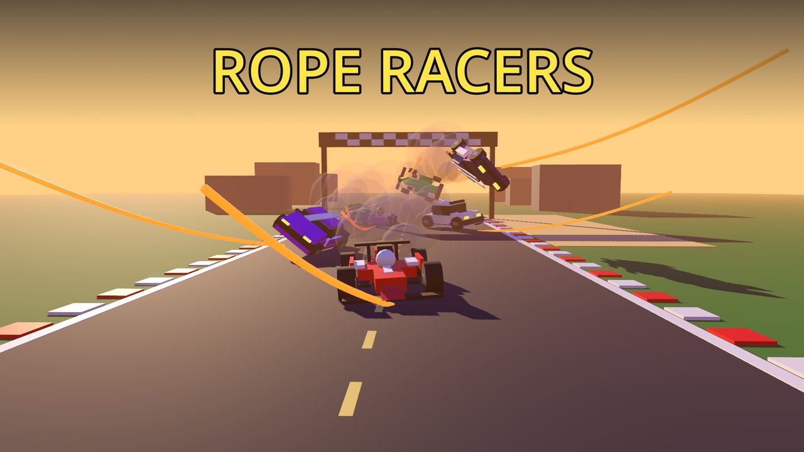
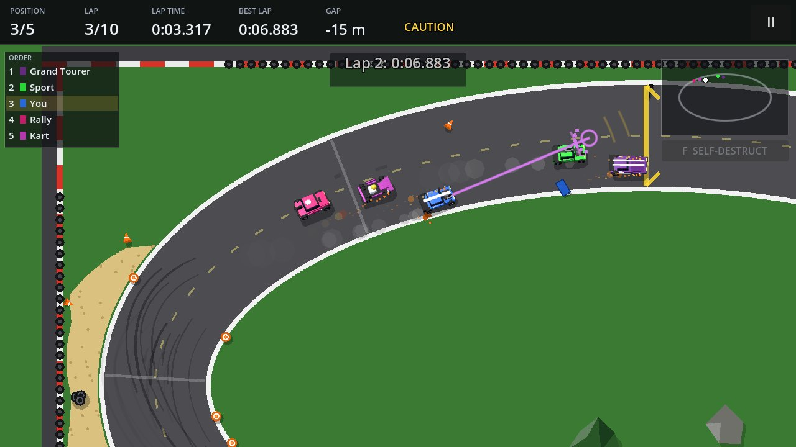
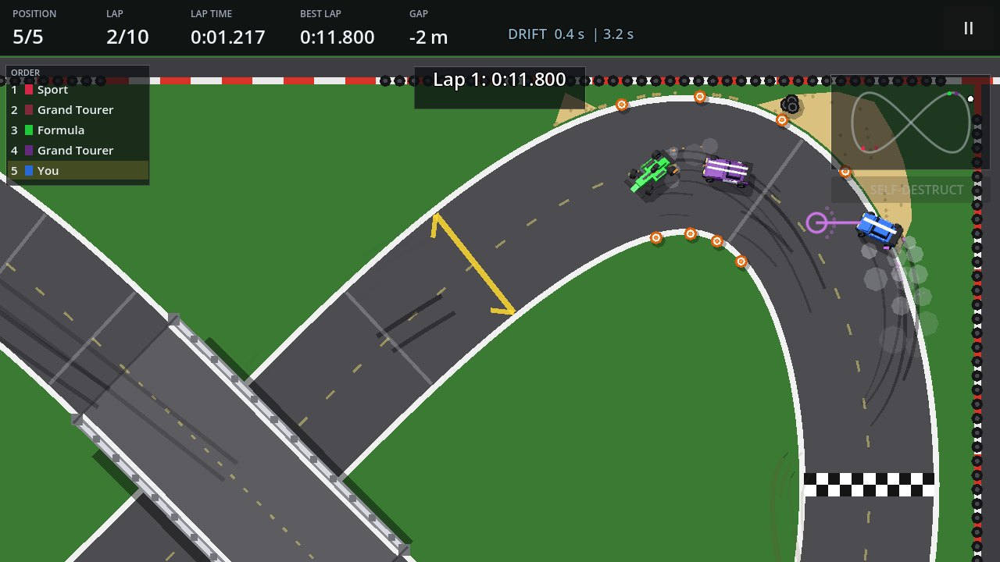
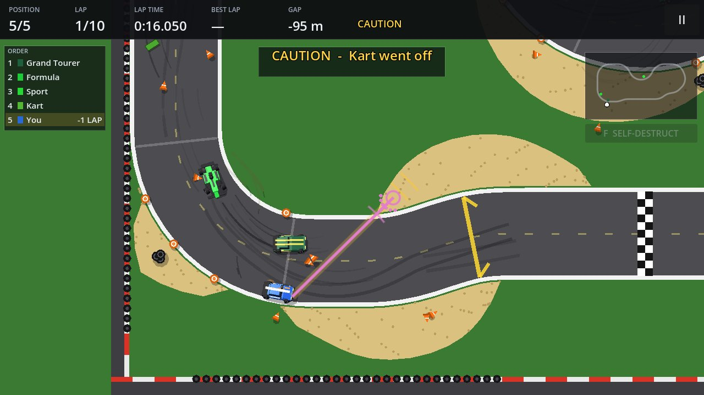
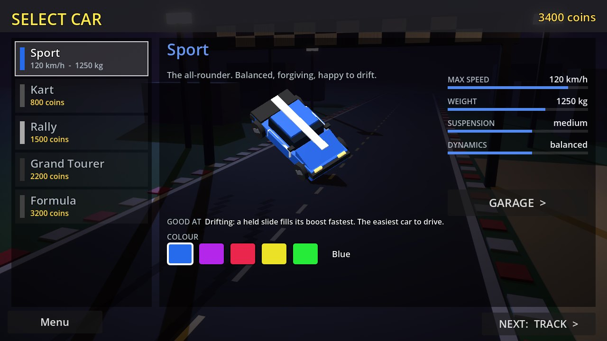
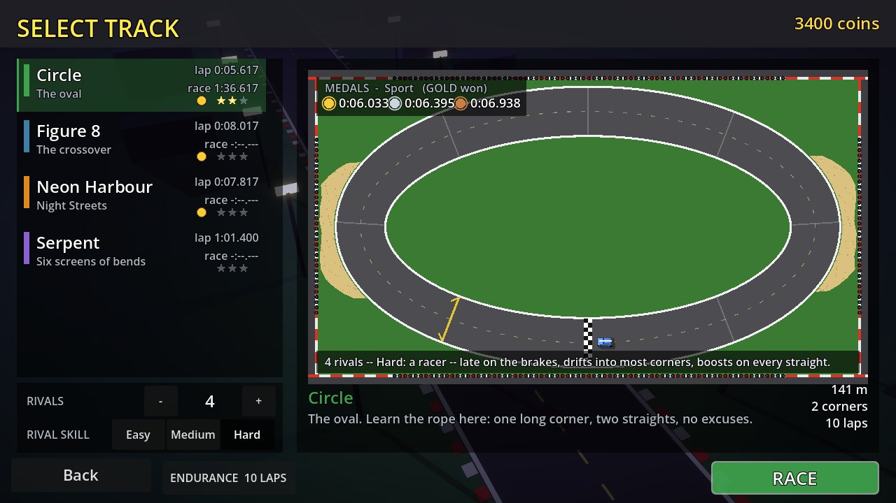
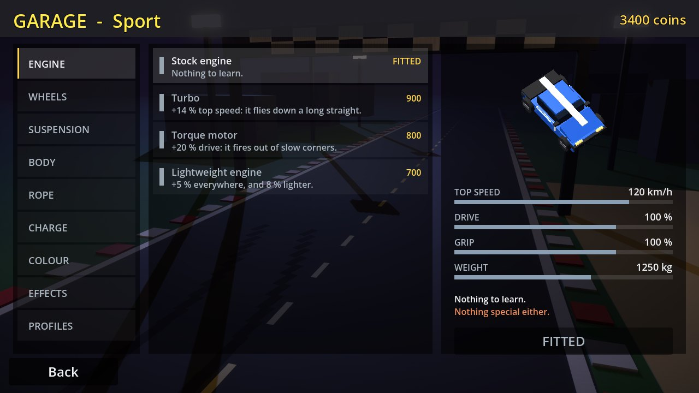
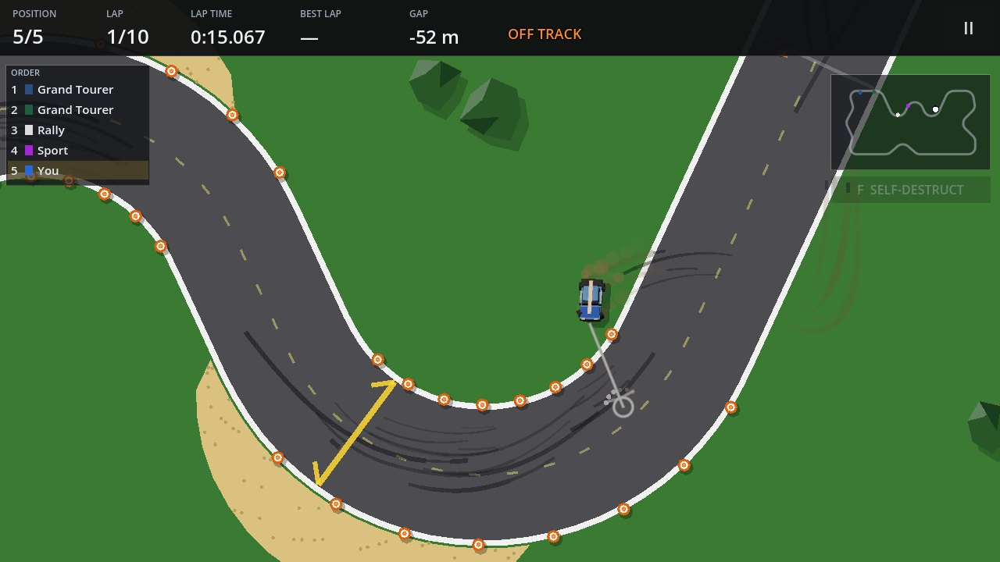

<p align="center">
  
</p>

<h1 align="center">Rope Racers</h1>

<p align="center">
  <b>A top-down racing game where your car is tied to the mouse by a rope.</b><br>
  Pull it, swing it, drift it — and keep the cursor close, because that is the only brake you have.
</p>

<p align="center">
  <a href="https://rope.thenakedcat.games"><b>▶ Play in the browser</b></a> &nbsp;·&nbsp;
  <a href="https://github.com/zzzteph/racers/releases"><b>Download</b></a> &nbsp;·&nbsp;
  <a href="#host-your-own-server"><b>Host a server</b></a> &nbsp;·&nbsp;
  <a href="docs/GUIDE.md"><b>Full guide</b></a>
</p>

<p align="center">
  
  
  
</p>

---



## The idea

There is no throttle and no steering wheel. The farther the cursor is from your car, the harder the rope
pulls — so distance is speed, and direction is steering. Hold the cursor far ahead into a bend and the rope
drags you straight off the road. Yank it sideways at speed and the rear steps out into a drift. Bring it
back toward the car and the tyres bite again.

Under the rope is a real car: a four-wheel tyre model with per-corner suspension, weight transfer, under-
and oversteer, tyre marks, and rollovers when you throw it at a corner badly enough. The world is flat 2D;
the cars are low-poly 3D models that lean, dive and barrel-roll.

<table>
  <tr>
    <td width="50%"></td>
    <td width="50%"></td>
  </tr>
  <tr>
    <td align="center"><sub>Figure 8 — over the bridge on one branch, under it on the other</sub></td>
    <td align="center"><sub>A rival's wreck brings out the yellow flag and bunches the field</sub></td>
  </tr>
</table>

## What's in it

- **Four circuits**, each a different job: the **Circle** to learn the rope on, the **Figure 8** with its
  bridge, **Neon Harbour**'s corner-after-corner streets, and the **Serpent** — six screens of bends with a
  camera that rides along. You can also [draw your own](docs/MAPPING.md) in the Godot editor.
- **Five cars** — Sport, Kart, Rally, Grand Tourer and Formula — each with its own top speed, weight,
  suspension and rope.
- **Rivals with personalities.** Up to four AI drivers — the Pro, the Hothead, the Drifter, the Rookie, the
  Bully — who crack under pressure, have big crashes and leave debris on the line.
- **Damage that matters.** Knock the nose and the engine loses power; clip a corner and the steering pulls;
  tyres wear, burst and run on the rim. You limp home, or write it off and respawn.
- **A career and a garage.** Win races to open tracks and earn coins; buy cars, parts that trade one
  strength for another (a turbo, slicks, a roll cage, a shorter rope), and effects you can see on track.
- **Medals and records** for every car on every track.
- **Online and LAN multiplayer** — rooms, quick join, private codes, chat, and a leaderboard on the
  official server.
- **Everything is made in code.** Every sound — engine, tyres, impacts, the chiptune soundtrack — is
  synthesised, and every picture is drawn or rendered from the game's own models. No external assets.

<table>
  <tr>
    <td width="33%"></td>
    <td width="33%"></td>
    <td width="33%"></td>
  </tr>
  <tr>
    <td align="center"><sub>Pick a car</sub></td>
    <td align="center"><sub>Pick a circuit and your rivals</sub></td>
    <td align="center"><sub>Spend your winnings in the garage</sub></td>
  </tr>
</table>



## Play

**In the browser:** [rope.thenakedcat.games](https://rope.thenakedcat.games) — the web build;
**Multiplayer → ONLINE** puts you on the official server.

**Download:** every version is on the [releases page](https://github.com/zzzteph/racers/releases), one zip
per platform:

| Platform | File | Run |
| --- | --- | --- |
| Windows | `RopeRacers-<version>-windows.zip` | `RopeRacers.exe` |
| Linux x86-64 | `RopeRacers-<version>-linux.zip` | `./RopeRacers.x86_64` |
| Linux ARM64 | `RopeRacers-<version>-linux-arm64.zip` | `./RopeRacers.arm64` |
| macOS (universal, unsigned) | `RopeRacers-<version>-macos.zip` | right-click → Open the first time |
| Web | `RopeRacers-<version>-web.zip` | serve the folder over http |
| Dedicated server | `RopeRacers-<version>-server.zip` | see below |

### Controls

The whole game is played with the mouse.

| Input | Does |
| --- | --- |
| **Move the cursor** | Steer and accelerate: the car is pulled toward it, and distance is throttle |
| **Cursor close to the car** | No pull — the car brakes to a stop |
| **Yank sideways at speed** | The rear steps out into a drift (a held drift charges the boost) |
| **Click** | Fire the boost when the meter is full |
| **II** / **Esc** | Pause |
| **M** | Music on / off |

## Host your own server

The dedicated server, the web build and an nginx in front of both ship as **one Docker image** on GitHub's
registry. Every push to `main` builds it (`.github/workflows/server-image.yml`):

```
ghcr.io/zzzteph/rope-racers:latest        # the newest build of main
ghcr.io/zzzteph/rope-racers:<version>     # one version, e.g. 0.14.6
```

**Run it** on any Linux box with Docker:

```sh
docker run -d --name rope-racers --restart unless-stopped \
  -p 127.0.0.1:8080:8080 \
  -v rope-racers-data:/app/.local/share \
  -e RR_NAME="My server" \
  -e RR_PUBLIC_URL="wss://racers.example.com/ws" \
  ghcr.io/zzzteph/rope-racers:latest

curl -fsS http://127.0.0.1:8080/healthz      # "ok"
```

One port, `8080`, serves everything:

| Path | What |
| --- | --- |
| `/` | the web version of the game |
| `/ws` | the game server (WebSocket) |
| `/api/servers` | the server's entry for the server list |
| `/healthz` | `ok` |

Put a TLS proxy in front of it (nginx, Caddy or Cloudflare — the browser build needs `wss://`).
[`deploy/nginx/`](deploy/nginx/) has a working nginx config. The `rope-racers-data` volume keeps the
**leaderboard** across redeploys.

**Update or roll back** with the bundled script, which pulls the image, replaces the container and checks
it answers:

```sh
sh deploy/run-from-ghcr.sh                  # :latest
TAG=0.14.6 sh deploy/run-from-ghcr.sh       # pin a version
```

**Settings** are environment variables (`-e NAME=value`):

| Variable | Default | What |
| --- | --- | --- |
| `RR_NAME` | The Naked Cat - Official | the server's name in the list and the title bar |
| `RR_MOTD` | Welcome to Rope Racers! … | one line above the room list |
| `RR_PUBLIC_URL` | wss://rope.thenakedcat.games/ws | the address players are given |
| `RR_MAX_ROOMS` | 32 | rooms at once |
| `RR_MAX_PLAYERS` | 96 | players at once |

> A game and a server must speak the same network protocol (shown in the menu corner as `net 9`), so
> update the server before handing out a build with a new one.

**Without Docker:** `./run_server.sh [port]` (Linux) or `RUN_SERVER.cmd [port]` (Windows) from a release
zip, or the server-only build: `RopeRacersServer.x86_64 --headless -- --server --port 7777`. Friends on
your network can also join a game you host from **Multiplayer → HOST LAN**.

The full walk-through — a VPS, nginx, Cloudflare, a directory of several servers — is in
[deploy/README.md](deploy/README.md).

## Build from source

Requires **[Godot 4.7.2](https://godotengine.org/download)**. Pure GDScript, no plugins.

```sh
godot --path .                                              # open in the editor; main scene: scenes/main_menu.tscn
godot --headless --path . --script res://tests/run_tests.gd # the test suite (748 checks)
sh tools/verify.sh                                          # the suite + the layout sweep: the one gate
sh deploy/release.sh                                        # test, export all six platforms, zip into build/release/
```

Publishing a version: bump `config/version` in `project.godot`, add its section to
[CHANGELOG.md](CHANGELOG.md), then **Actions → release → Run workflow**.

## Learn more

- **[The full guide](docs/GUIDE.md)** — every track, car, part and setting; multiplayer in detail; the
  project layout; every tuning constant of the car, the tyres and the rope.
- **[Making your own tracks](docs/MAPPING.md)** — draw a circuit in the Godot editor and race it.
- **[Changelog](CHANGELOG.md)** — what changed in each version.
- **[Tests](tests/README.md)** — what the suite covers.
